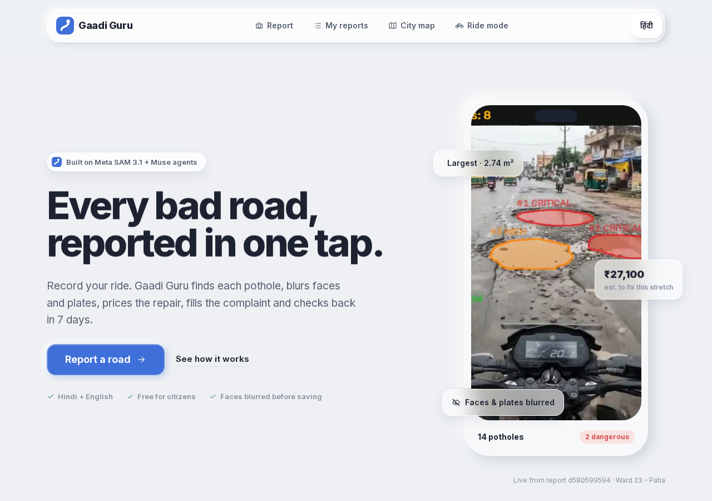
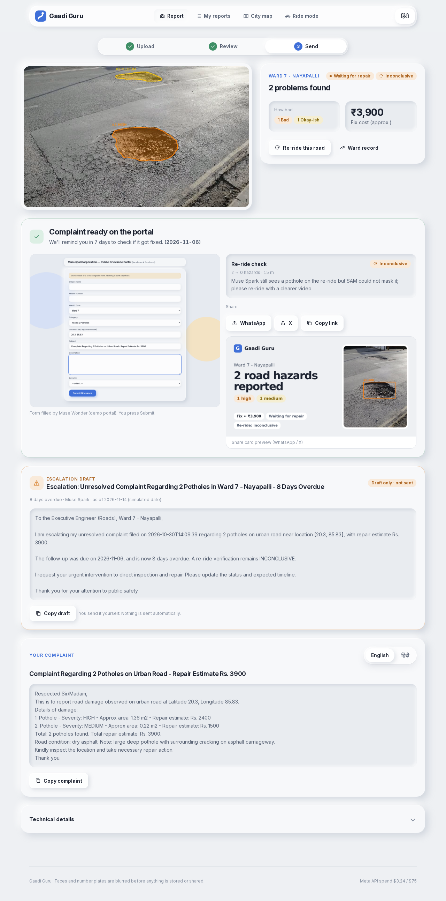
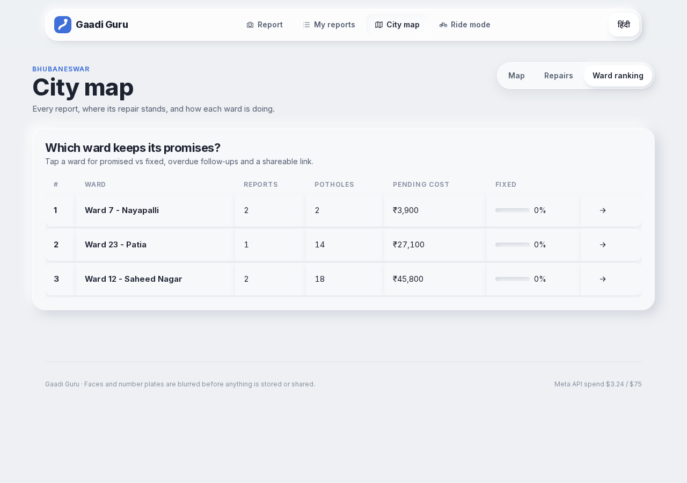
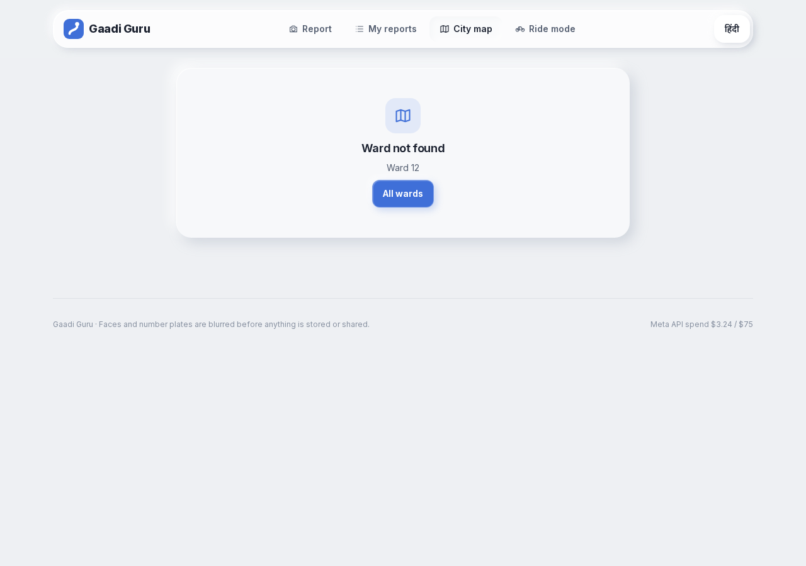
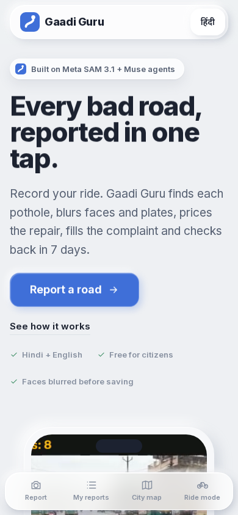
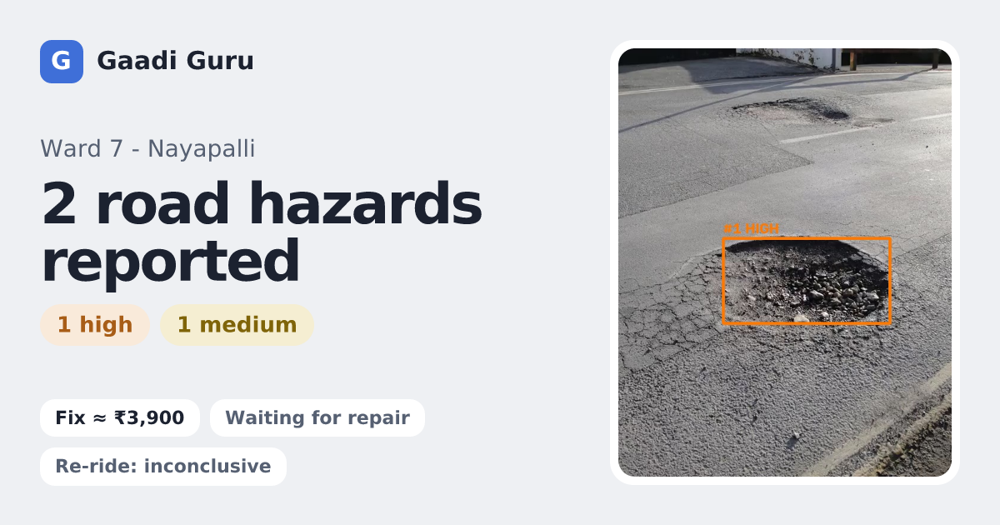

# 🛵 Patchwise — Ride. Record. Report.

**Turn a phone video of any Indian road into a measured, privacy-blurred, geotagged pothole complaint in about a minute.** It's powered by Meta **SAM 3.1** video segmentation, **Muse Spark** and **Muse Voice Transcribe**.

> In 2023, **2,161 people died in pothole-related crashes in India** (MoRTH, *Road Accidents in India 2023*). Most potholes never get reported, and the ones that do are reported as one blurry photo with no size, no location and no follow-up.

Built for the **Meta Global AI Developer Hackathon** (Indie track, "Build for Your World").

## What it does
1. **Upload a ride clip** from a bike, auto or car dashcam, with an optional Hindi or English voice note.
2. **Muse Spark looks at sampled frames and plans the inspection.** It describes the road type and surface, and picks the noun phrases SAM should segment (`pothole`, `water-filled pothole`, …).
3. **SAM 3.1 segments and tracks** every pothole through the video. It runs one concept per request, gives stable object IDs across frames, and returns `one_bit` masks.
4. **Dedup.** SAM track IDs, plus same-frame IoU merging, collapse repeat sightings so one pothole counts once.
5. **Severity.** The decoded mask area (not just the box) at the closest sighting, as a share of the frame, is weighted by how long the pothole stays visible. Each pothole is scored 0–100 and labelled LOW, MEDIUM, HIGH or CRITICAL.
6. **Privacy.** SAM 3.1 also segments `license plate` and `human face`, and those regions are Gaussian-blurred before any image leaves the system.
7. **Voice.** Muse Voice Transcribe turns the citizen's Hindi or Hinglish note (WAV, 16-bit mono, 16 kHz) into text.
8. **Complaint.** Muse Spark writes a factual bilingual (English + हिंदी) complaint with the counts, severities and GPS location.
9. **Heatmap.** Every report is added to a city heatmap with a shareable report link.

## Architecture
```
Next.js (upload · results · Leaflet heatmap · /report?id=)
        │  multipart POST /analyze
FastAPI backend ──► ffmpeg normalise (≤20 s, 8 fps → cheap SAM frames)
        ├─► muse-spark-1.3        plan prompts (vision)      /v1/responses
        ├─► Files API upload      → file_id
        ├─► sam-3.1 × N phrases   track + masks (stream)     /v1/responses
        ├─► sam-3.1 plate/face    privacy blur
        ├─► muse-voice-transcribe-1.0                        /v1/asr/transcribe
        └─► muse-spark-1.3        bilingual complaint JSON
```
| Meta model | Used for |
|---|---|
| `sam-3.1` | pothole segmentation and tracking in video, mask-area severity, plate and face privacy masks |
| `muse-spark-1.3` | visual inspection planning and complaint writing |
| `muse-voice-transcribe-1.0` | Hindi/English voice notes |
| `muse-wonder-1.0` | computer-use agent that fills the complaint on the municipal portal and stops before Submit |

## Features
| | |
|---|---|
| **Civic agent** | Muse Spark tool loop: `analyze_video → check_duplicates → estimate_repair_cost → draft_complaint → file_complaint → schedule_followup (+7 d) → verify_repair`. Every step streams to a timeline on the report page (`POST/GET /reports/{id}/agent`). |
| **Portal filing** | Muse Wonder drives a real browser (Playwright) over a local mock grievance portal (`/mock-portal`), fills all fields, and **stops before Submit**. A click on Submit or Enter in a field is blocked in code. The native `computer` tool isn't enabled on our key, so the same observe→act loop runs through `cua_*` function tools. |
| **Multi-hazard** | Spark picks at most 3 SAM phrases (to limit cost) from: pothole, open manhole, waterlogged road, garbage dump, broken road divider, broken streetlight. |
| **₹ repair estimate** | Uses the mask area share × 30 m² of visible road × ₹1,800/m² for patching, with a ₹1,500 minimum per site. Hazard-specific rates are in `pipeline.py`. These are assumptions, not CPWD SOR. |
| **Repair board + ward leaderboard** | `/repairs` columns run Reported → Filed → Promised → Fixed (verified by re-ride). Wards are ranked by fix rate. |
| **Live ride** | `/ride`: phone camera; one frame every 2.5 s goes to SAM 3.1 image ($0.0025 per frame); auto-stops at 5 min. A pothole in the lower half of the frame triggers a spoken hi-IN alert, “आगे गड्ढा है”. |
| **Dedup** | Tracks are merged across prompts and re-appearances (IoU/nesting union-find plus a 1 s re-entry window). Whole-road boxes and 1-frame flickers are dropped. |
| **Privacy** | Faces and plates are found by SAM 3.1 and Gaussian-blurred in every saved image and the COCO export. |
| **COCO export** | `/reports/{id}/coco` and `/dataset/coco` export RLE masks with severity attributes. |
| **Budget guard** | Every Meta call is priced and logged to `backend/data/costs.jsonl`, and calls are refused once the total passes $70 (`GET /costs`). The same video is cached by SHA-256 and never re-analysed. |

## What's new in v4
| | |
|---|---|
| **Re-ride verification** | A "Re-ride this road" button on every report compares a new ride with the original (`verify_repair`). The verdict is **fixed / not fixed / inconclusive / not comparable**, shown as badges on the report, map rings and the repairs board. If Spark still sees a pothole that SAM can't mask, the verdict is *inconclusive*, never a false "fixed". |
| **Ward accountability** | `/map/ward?w=…` shows promised vs fixed, overdue follow-ups with days overdue, the report list, and a shareable link (WhatsApp / X / copy). API: `GET /wards/{ward}/accountability`. |
| **Offline ride queue** | Ride mode saves frames to IndexedDB when offline, in low-network mode, or when an upload fails. Back online, they go to `POST /rides/offline`, are stitched with ffmpeg, and run through the normal job pipeline. |
| **Follow-up job** | Every 10 minutes, `followup.run_due` checks overdue reports. Anything not verified fixed gets an **escalation draft** (Muse Spark, with a template fallback). It is draft only: `sent: false`, and nothing is ever sent. `POST /followups/run`, `GET /reports/{id}/escalation`. |
| **Share card** | `/r/{id}` has Open Graph/Twitter tags and a 1200×630 PNG card (`next/og`). |
| **Design system** | One set of components: buttons, inputs, cards, badges, tabs, toasts, modals, skeletons and empty states. 8px spacing, a type scale, Framer Motion page transitions, light clay + glass with no gradients, and a mobile bottom tab bar. |

| Landing | Report (sent, re-ride, escalation) | Ward ranking |
|---|---|---|
|  |  |  |
| **Ward page** | **Mobile** | **Share card** |
|  |  |  |

Demo script: [`docs/DEMO_SCRIPT.md`](docs/DEMO_SCRIPT.md).

## Tests (zero Meta spend)
```bash
# backend: every endpoint + all 7 agent tools + the agent loop with a fake model.
# Runs on a temp copy of backend/data; every Meta call is blocked and a test fails if spend changes.
.venv/bin/python -m pytest backend/tests -q

# browser E2E: needs the frontend on :3000 (it calls http://localhost:8000; the tests reroute that).
# The suite starts its own API on :8011 over a temp copy of data/ with GG_FAKE_META=1, so live reports are never touched
# and the offline-ride test runs the real ffmpeg stitch + job pipeline with Meta faked server-side.
.venv/bin/pip install playwright pytest && .venv/bin/python -m playwright install chromium
.venv/bin/python -m pytest e2e -q            # E2E_VIDEO=/tmp/vid SLOW=1000 to record videos
```
`GG_DATA=/path` points the backend at a different data dir. `GG_FAKE_META=1` swaps every billable Meta call for an empty, free answer (tests only).

## Deploying (not done; needs accounts)
- **Backend:** Render, Railway, Fly.io or a VM. It needs ffmpeg plus Playwright Chromium (about 400 MB), `MODEL_API_KEY` as a secret, and a persistent disk for `backend/data`. It's not a fit for Vercel functions, which have no ffmpeg/Chromium and 60 s timeouts against our 1–2 min SAM video runs.
- **Frontend:** Vercel or Netlify, with `NEXT_PUBLIC_API_URL` set to the backend URL. HTTPS is required for the live-ride camera.
- **Real portal filing:** this needs per-city portal access (most require an OTP login) and the citizen's consent, so the demo uses the local mock.

## Run it
```bash
# backend
python -m venv .venv && .venv/bin/pip install -r backend/requirements.txt
export MODEL_API_KEY=...            # never commit it; .gitignore covers .env / .meta_key / .secrets
cd backend && ../.venv/bin/uvicorn app.main:app --port 8000
# frontend
cd frontend && npm i && NEXT_PUBLIC_API_URL=http://localhost:8000 npm run dev
```
Requires `ffmpeg`.

## Run locally (Windows)
```powershell
# 1. Put your key in backend\.env  (git-ignored, never commit it)
#    MODEL_API_KEY=your_key_here
# 2. Install ffmpeg:  winget install Gyan.FFmpeg   (then reopen the terminal)
py -3.12 -m venv .venv
.venv\Scripts\pip install -r backend\requirements.txt
cd backend
..\.venv\Scripts\python -m playwright install chromium   # for the Muse Wonder portal agent
..\.venv\Scripts\uvicorn app.main:app --port 8000
# new terminal
cd frontend
npm install
$env:NEXT_PUBLIC_API_URL="http://localhost:8000"; npm run dev   # open http://localhost:3000
```
The key is looked up in this order: the `MODEL_API_KEY` env var → `backend/.env` → repo-root `.env` → `MODEL_API_KEY_FILE`.

## De-risk results (Oct 30, 2026)
These are real API calls. Results are in [`docs/DERISK.md`](docs/DERISK.md).

## License
MIT

## UX (v2)
- One primary action: **Report a road** → 3-step flow (Upload → Review → Send) with a progress stepper.
- Video **or photo** upload, optional voice note, auto location + nearest ward, "Same pothole? Upvote it" for nearby open reports.
- Plain words ("How bad": Dangerous / Bad / Okay-ish / Minor), Hindi/English toggle, mobile-first, 44px+ tap targets.
- Success screen: WhatsApp / X / copy-link share, 7-day reminder; **My reports** lists reminders.
- **City map** has tabs: Map · Repairs board · Ward ranking. Technical details (SAM masks, COCO export, agent timeline) are folded away.
- New API: `GET /nearby`, `POST /reports/{id}/upvote`, `GET /followups`; `/analyze` accepts images.

## Accounts and authorities

- **Accounts (optional):** Supabase email magic link. Copy `frontend/.env.example` to `frontend/.env.local`. Then run `supabase/schema.sql` once in the Supabase SQL editor. Reports are stored per user with RLS. The public map and reports work without login. If Supabase is unreachable, the app falls back to the on-device list.
- **Authorities:** `backend/app/authorities/authorities.json`. The city comes from OpenStreetMap Nominatim, at most 1 request per second, cached, and attributed. Users can override the city. "Send to authorities" opens a prefilled email in English and Hindi. It only uses emails with medium or high confidence; otherwise it points to the portal and helpline. Portal format cards give a copy button for each field.
